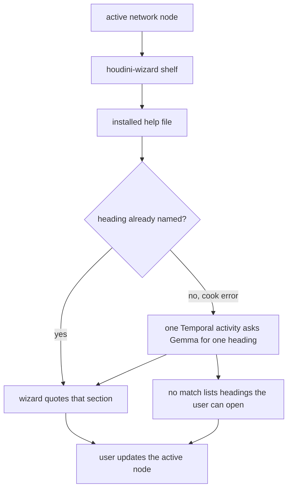

# Flow

Shelf click for the node you already have selected. The card quotes one section from the help that shipped with this Houdini. You still change the node.

Gemma does not parse the heading into new text. It chooses one heading already in the file. A selected parameter wins. Otherwise it matches the cook error to those headings.

The card does not link out to the long `?` article. It quotes the section. On no match, the list is the file’s own headings. You open one. The shelf does not choose the next topic for you.

A multi-process agent harness is for a loop: the model picks the next tool, several processes talk, and the plan can change. This shelf is a fixed path. Opening a node saves that card, whether or not it has a cook error. Python quotes a heading that is already named, and that save does not call Gemma. The only step that can time out, and must not run twice, is Gemma choosing one heading when a cook error names none. That call is an Activity on the same card. The help text stays in the Houdini process. Closing Houdini stops the service process, and the saved cards stay in the local database. The browser stays closed. Session log and Developer monitor are buttons on the panel, and each opens only when you click it.
