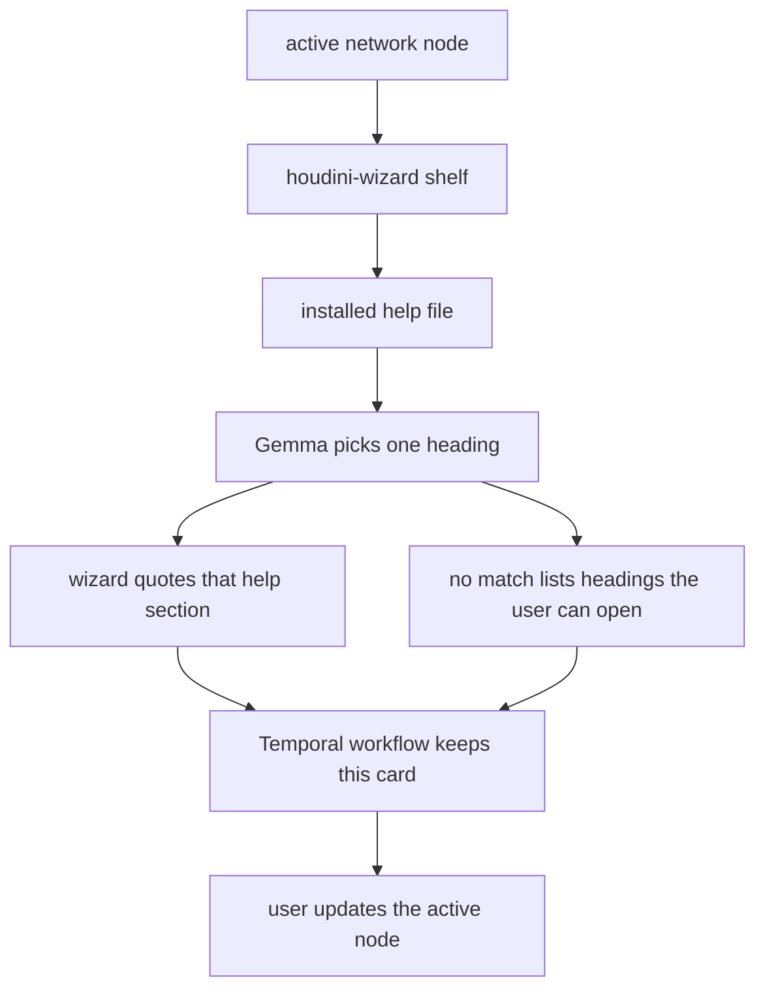

# Flow

Shelf click for the node you already have selected. The card quotes one section from the help that shipped with this Houdini. You still change the node.

Gemma does not parse the heading into new text. It chooses one heading already in the file. A selected parameter wins. Otherwise it matches the cook error to those headings.

The card does not link out to the long `?` article. It quotes the section. On no match, the list is the file’s own headings. You open one. The shelf does not choose the next topic for you.

Temporal here is one Python workflow that retries the pick and restores this card. It is not the multi-process agent harness. It stores the find for this node, and the next click after a quit brings that card back. A new cook error is a new card, because the node in front of you changed.
