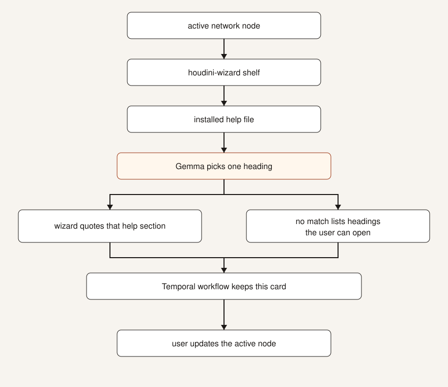

# Houdini wizard tool

Shelf tool for Houdini. Select a node, or a parameter whose channel is selected. The window stays open while you work, and it follows the next node you select. It shows that node's inputs and outputs, then each parameter with the menu choices from the help that shipped with this install, including the pictures on the shelf page. You still set the values and the look.



The same labels are in [FLOW.md](FLOW.md).

You still change the node. The shelf does not set a value.

## What is added to Gemma

Gemma does not know this shelf. `skills/houdini-section/SKILL.md` is sent only when a cook error does not already name a heading. It tells the model to return one heading from the list it was given, or `none`. A normal Ollama chat can paraphrase the help or invent a number. This file forbids both.

Python quotes the section. The model never writes the card.

Add another file under `skills/` when a later call needs its own constraint, and name it here.

## Help files

Houdini stores node help as wiki text in `$HFS/houdini/help/nodes.zip`. One member is one node, for example `sop/box.txt`.

A heading is a `= Title =` line, a `== Folder ==` line, or a parameter `Label:` under `@parameters`. The real parameter names are on the next `#channels:` line (`/sizex` belongs to Size). A more-indented `Label:` is a menu choice on that parameter. The panel lists those choices with the sentence the help file gives them. A `:include` of a shelf page can add the short steps and the pictures. The shelf reads that one node, that included page, and those image bytes. It does not extract the archives or start the help server behind `?`. The split for that node is kept for the rest of the Houdini session.

## Model

This click is one constrained choice, so the model to pull is `gemma3:4b`. It is the speed and accuracy balance for a short JSON heading. Ollama's `format` schema limits the reply to a heading from the file, or `none`.

`deepseek-r1:8b` is a reasoning model. It spends the click on a hidden chain of thought. Leave it for other work.

```powershell
ollama pull gemma3:4b
```

To use another Gemma tag, set `HOUDINI_WIZARD_MODEL` before the worker starts.

## Temporal

The feature is one durable Workflow, written with the Temporal Python SDK. A multi-process agent harness is a different kind of tool: the model chooses the next step, and several processes keep a conversation going. This shelf already knows the steps. A heading named by the parameter or the cook error is quoted from the installed help, in process, with no model and no workflow. Gemma runs only when a cook error names no heading, and it may only return one of those headings or `none`.

That single call is the workflow:

- It is one Activity, with three attempts. If Gemma times out, the same run tries again. It does not start a second call that might both succeed.
- The workflow id is the node, the parameter, and the cook error. Opening that same error while the run is still going waits for it. The model is not asked twice.
- The help text never enters the workflow. Temporal receives the heading names and the error, and returns one heading. Python quotes the section.
- The heading is then written to one file in the Houdini user preferences, `houdini_wizard/cards.json`, keeping the newest picks. The finished workflow is removed, so a session of node clicks does not become a session of rows in `.temporal\dev.db`.
- The service starts when the tool opens, with no console window. It stops when Houdini exits, including when Houdini is ended from outside, so the process does not stay behind.

The monitor at [http://localhost:8233](http://localhost:8233) shows a run while that heading pick is in progress. A normal node, and a finished pick, do not leave a row. The help window says **From this install** for a quote, and **Saving**, **Saved**, or **Restored** for a heading the model had to choose.

Temporal's docs describe `temporal server start-dev` as the local development server, a single program with a database file, not a production cluster and not a window the artist keeps open. A production service would be [Temporal Cloud or a self-hosted cluster](https://docs.temporal.io/production-deployment). This tool uses the local server because the artist is on one computer, and the durable part is the in-flight model call, not a ledger of every click. The same command, if you ever want to start it yourself, is:

```powershell
temporal server start-dev --db-filename D:\Documents\vscode\houdini-wizard\.temporal\dev.db
```

## Install

Houdini is the only thing to install first. From this folder, one command installs the shelf and prepares Temporal:

```powershell
powershell -ExecutionPolicy Bypass -File .\setup.ps1
```

Restart Houdini. The shelf tab is **Houdini Wizard**. The tool is **Section card**. Opening it starts the monitor at [http://localhost:8233](http://localhost:8233). Pull the model once if you want heading picks: `ollama pull gemma3:4b`.

1. Select a node.
2. To quote one parameter, click its name so that channel is selected, then click the shelf. The label or the `#channels` name has to match a heading. Gemma is not called.
3. A cook error that already contains a heading quotes that section. Gemma is not called.
4. A cook error that does not name a heading asks Gemma, inside the Temporal workflow.
5. If nothing matches, the dialog lists the file's headings. You open one.

Clicking other nodes updates the help. The banner says **From this install**, and the monitor does not gain a row. A cook error that does not name a heading is the one that shows Saving, then Saved. Quit Houdini and the service process stops. Open the tool on that same error again. The banner says Restored, the model is not asked again, and the heading came from the one local file.

Short value lines that needed the model are remembered in the Houdini user preferences. They are not a separate workflow.

## Why the code exists

Entire records the agent session that built this tool. The shelf click does not call it. A technical reader asks from this repository:

```powershell
python -m houdini_wizard.why "why a named heading skips Gemma"
```

With no question, the same command lists the checkpoints for the build, each tied to the commit it produced. One checkpoint, `01M5QRE9FZAKB6Q9V2K6HRS78R`, is the session where the card became one Temporal workflow: the heading pick is an activity with three attempts, and a heading that is already named never becomes that activity. `entire checkpoint explain <id>` opens that session. The artist-facing card stays the help quote.
